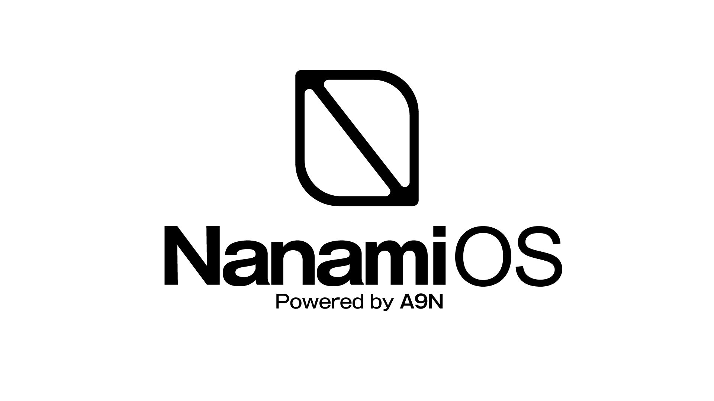

# Nanami OS

<p align="center">
  
</p>

Nanami is an experimental user-space operating system built on the
[A9N Microkernel](https://github.com/horizon2038/A9N). It keeps the kernel
small and implements OS policy, device drivers, filesystems, networking,
graphics, and ABI compatibility as isolated user processes connected through
capabilities and IPC.

Nanami is written primarily in Rust and uses the
[Nun](https://github.com/horizon2038/Nun) runtime. The complete bootable UEFI
image is assembled by [SPENCER](https://github.com/horizon2038/spencer), which
combines Nanami with A9N and
[A9NLoader-rs](https://github.com/horizon2038/a9nloader-rs).

> [!WARNING]
> Nanami is under active development. Its user-space ABI, service protocols,
> filesystem format assumptions, and supported application interfaces may
> change without compatibility guarantees.

## Architecture Overview

```text
UEFI
  -> A9NLoader-rs
  -> A9N Microkernel
  -> Nanami Alpha
       -> boot-critical services from initramfs
       -> system services from ext2 rootfs
       -> Honoka desktop and user session
```

The system is divided into the following layers:

- **A9N Microkernel** provides capability spaces, address spaces, scheduling,
  IPC, interrupt delivery, and the minimum hardware-dependent mechanisms.
- **Nun** provides the Rust runtime and entry ABI used by Nanami and its
  user-space programs.
- **Alpha** is Nanami's initial and privileged user process. It manages
  physical memory, processes, virtual memory metadata, service discovery, and
  privileged resource requests without moving those policies into the kernel.
- **Servers and drivers** implement storage, filesystems, networking, input,
  graphics, terminal sessions, timers, and POSIX-facing services as separate
  processes.
- **Honoka** is the compositor and window manager used by the graphical
  desktop.
- **Alter** provides user-space ABI personalities for running supported Linux
  and FreeBSD binaries on Nanami services.
- **SPENCER** builds A9N, A9NLoader-rs, Nanami, and the final UEFI disk image
  through a single build pipeline.

Nanami uses synchronous IPC for control operations and shared memory, DMA
buffers, ring buffers, and notifications for high-frequency data paths.
Drivers and subsystem servers are not linked into Alpha or the microkernel.

## Features

- Capability-based process, memory, device, and service management
- A user-space Device Driver Manager that selects platform drivers at boot
- User-space drivers for AHCI, virtio block/network, HPET, PIT, PS/2, USB xHCI HID/BOT, RTC, and
  the boot framebuffer
- ext2 root filesystem with application and service manifests
- IPv4 networking with DHCP, ARP, ICMP, UDP, DNS, and TCP support
- Honoka compositing desktop with shared-memory windows and input delivery
- Terminal service and graphical shell
- POSIX-oriented file descriptor, process, filesystem, terminal, and socket
  services
- Alter/Linux and Alter/FreeBSD syscall emulation layers
- Native Rust and freestanding C++ application SDKs
- Runtime memory and process inspection through `nanami-info` and the graphical
  performance monitor

## Boot Model

Nanami separates boot policy into three stages:

1. `nanami/servers/boot-list` is embedded in the initramfs and contains only
   boot-critical services. The Device Driver Manager selects the timer and
   block drivers before VFS and the system manager consume them.
2. `/nanami/system-list` is read from the ext2 root filesystem and starts upper
   services such as networking, input, graphics, POSIX, and Alter.
3. `/nanami/session-list` starts the user session after system services are
   available. The default session launches the graphical shell.

This keeps Alpha independent of desktop, application, and root filesystem
policy.

## Supported Targets

| Architecture | Platform | Status |
| --- | --- | --- |
| x86_64 | QEMU/UEFI | Supported |
| AArch64 | QEMU `virt`/U-Boot | Supported (headless) |
| AArch64 | Hardware | Planned |
| riscv64 | QEMU or hardware | Planned |

x86_64's user-space Device Driver Manager maps the RSDP supplied in
`arch_info[0]`, validates the RSDP and XSDT/RSDT, and discovers HPET itself.
It selects AHCI through PCI, with virtio-blk and PIT retained as fallbacks.
AArch64 uses a PCI boot disk and a modern virtio-mmio root disk on QEMU `virt`
with GICv2. Its user-space timer is intentionally deferred: EL0 access to the
architectural virtual timer is not enabled or exposed.

## Requirements

- Supported build/run hosts: macOS and Linux
- Rust nightly specified by `rust-toolchain.toml`, including `rust-src`
- LLVM/Clang: `clang`, `clang++`, `llvm-ar`, `llvm-objcopy`, `ld.lld`,
  `llvm-config` on PATH
- CMake 3.29+, Ninja, and NASM (x86_64)
- QEMU for the selected architecture and Git with submodule support
- Docker for AArch64 U-Boot builds

Host orchestration, ext2 and initramfs generation are Rust. Bash, Python,
cpio, GNU Make and host filesystem utilities are not required for the
x86_64 build/run path. Makefiles are optional wrappers.
A9N's unchanged toolchain requires `llvm-config`.
AArch64 U-Boot uses a Linux Docker container, not a host shell script.
OVMF is provided by the A9NLoader-rs submodule.

## Build

```text
git clone --recursive git@github.com:horizon2038/Nanami.git
cd Nanami
git submodule update --init --recursive
cargo xtask build
```

This builds native Rust/C++ services, generates the initramfs in Rust, creates
the rootfs if missing, and calls SPENCER's Rust build library for A9N, Nanami,
the loader and disk assembly. A9N uses CMake + Ninja. The default target is
x86_64/pc99, release, with SMP enabled.

```text
cargo xtask build --arch aarch64 --no-linux-bins
cargo xtask build --profile debug
cargo xtask servers
cargo xtask build --help
```

For AArch64, omit the default x86_64 `bin/` with `--no-linux-bins`, or
supply an AArch64 directory with `--linux-bin-dir`. Architecture-specific
startup manifests are selected automatically. Default boot disks:

```text
spencer/out/x86_64-pc99-release/spencer.img
spencer/out/aarch64-qemu-release/spencer.img
```

The x86_64 disk contains a FAT32 EFI partition plus a Nanami ext2 partition,
identified by GPT type `6e616e61-6d69-4f53-a000-4e414e414d49`.
AArch64 QEMU uses a separate root disk.

Create or intentionally regenerate the rootfs:

```text
cargo xtask rootfs --rootfs out/new-ext2.img --size-mib 64
cargo xtask build --rebuild-rootfs
```

Existing staging rootfs images are reused unless `--rebuild-rootfs` is
supplied; `rootfs` refuses to overwrite one without that flag.
Building still replaces the boot disk: x86_64 guest writes are in
`spencer.img`, not `out/ext2.img`. Back up saved guest data before rebuilding.
Use `--output-image out/test-boot.img --rootfs out/test-rootfs.img` for an
isolated build.

## Run with QEMU

Run an existing image without rebuilding:

```text
cargo xtask run
cargo xtask run --snapshot
cargo xtask run --build --rebuild-rootfs
cargo xtask run --arch aarch64 --net none
```

`--snapshot` prevents guest writes from changing disks. AArch64 is headless
and currently has no native timer/display/input/network stack.

User networking is the x86_64 default, forwarding guest HTTP port 80 to
`127.0.0.1:1234`. Select a bridge explicitly:

```text
cargo xtask run --bridge-if en0 --sudo
cargo xtask run --bridge-if br0
cargo xtask run --net user --hostfwd tcp:127.0.0.1:8080-:80
```

macOS uses vmnet (`en0` example); `--sudo` elevates only QEMU, never the
build. Linux needs an existing bridge (`br0` example) and bridge-helper
permissions. Bridge setup is not automatic.
`BRIDGE_IF` and `NET_MODE` remain supported; explicit `--net` wins.

| Option | Default | Purpose |
| --- | --- | --- |
| `--storage` | `usb` | Root controller: `usb`, `ahci`, `virtio` |
| `--no-usb-input` | off | Omit USB keyboard/mouse; PS/2 remains available |
| `--no-hpet` | off | Exercise PIT fallback |
| `--memory` / `--smp` | `4G` / `4` | RAM / CPU count (1–64) |
| `--accel` | `auto` | Native KVM/HVF where applicable; otherwise TCG |
| `--net` | `user` on x86_64 | `user`, `bridged`, `none` |
| `--pcap` | none | Optional packet capture |
| `--image` | target boot disk | Boot another existing disk |
| `--headless` / `--gdb` | off | No display / paused GDB server |
| `--print-command` | off | JSON argv; no launch or firmware writes |
| `--dry-run` | off | Show actions without executing them |

Extra QEMU arguments follow `--`, without shell expansion:

```text
cargo xtask run --storage ahci -- -no-reboot
cargo xtask run --storage usb --net none
cargo xtask run --help
```

Apple Silicon uses software emulation for x86_64.
The launcher creates xHCI before USB children. Rootfs enumeration precedes
input-service. USB storage requires 512-byte sectors and a valid Nanami GPT root
partition. External hubs, UAS and AArch64 USB are unsupported.
See [USB validation and limits](tests/usb/README.md).

## Boot on x86_64 hardware

`cargo xtask build` produces the complete disk image at
`spencer/out/x86_64-pc99-release/spencer.img`. Write that one image to a whole,
dedicated SATA/AHCI disk or compatible USB memory connected directly to xHCI,
then select its UEFI boot entry. Both the EFI partition and initial rootfs are
in this image; no second disk is needed. NVMe and UAS are not storage backends
yet. The write
replaces the target disk's partition table and all existing contents, so
identify the device by model and capacity and unmount its volumes before
writing; do not use a system disk or a partition path. The firmware must support
x86_64 UEFI, and Secure Boot must be disabled unless the EFI loader is signed.

At runtime, the boot-selected PCI and USB storage drivers probe their supported
disks read-only. Driver Manager permits block-device publication only after
all probes finish and exactly one Nanami root is found across them. The service
exposes only partition-relative I/O to ext2-server. This selects by the unique
Nanami GPT partition type, not by a firmware boot-device identifier. Multiple
Nanami roots are rejected; reconnecting USB storage does not retarget an
already-mounted rootfs to the replacement device.

Nanami reads the architecture name, platform name, and available core count
from A9N v0.3.0's `init_info`; it does not probe PCB affinities to discover cores.
Alpha stays on logical Core 0. Services and applications are assigned to
the remaining cores in round-robin order. A single-core guest remains
supported and places all processes on Core 0. Inside the guest,
`nanami-info smp` reports the topology, and `nanami-info platform` reports the
kernel-supplied architecture, platform, and available core count.

## External ABI Binaries

The root filesystem builder can install external binaries for Alter. For
example:

```text
cargo xtask rootfs --rootfs out/custom-ext2.img --linux-bin-dir "path/to/linux binaries"
cargo xtask rootfs --rootfs out/freebsd-ext2.img --freebsd-bin "path/to/sh"
```

All regular files in the selected Linux directory are collected recursively,
including hidden/data files, without a hard-coded executable list. The default
is `bin/`; `LINUX_BIN_DIR` is also accepted. Basenames are used and a trailing
`.elf` is removed. Duplicate names, host links and special files are errors.
Use repeatable `--linux-bin` / `--freebsd-bin` for extra files,
`--no-linux-bins` to omit the default directory, and `--linux-rootfs-dir`
for an additional tree under `/alter/linux`.

Linux binaries are installed under `/alter/linux/bin`; FreeBSD binaries are
installed under `/alter/freebsd/bin`. Alter/Linux selects x86_64 or AArch64
syscall numbers, register layouts, ELF machine validation, and Linux structure
layouts at build time. Its filesystem subset includes `link(2)`/`linkat(2)`, so
BusyBox applet installation can create hard links. Compatibility still depends
on the syscalls and flags used by each program.

## Repository Structure

```text
.
├── nanami/
│   ├── src/                    # Alpha and Nanami OS core
│   ├── docs/                   # Architecture and application documentation
│   └── servers/
│       ├── core-services/      # Boot-critical initramfs services
│       ├── apps/               # Rootfs services and applications
│       ├── uapi/               # ABI/protocol definitions and C++ headers
│       ├── libs/               # nanami-runtime, nanami-client and implementation crates
│       └── targets/            # Native targets and linker scripts
├── crates/ext2-image/           # Reusable Rust ext2 image builder
├── xtask/                      # Portable build, rootfs, initramfs and QEMU commands
├── spencer/                    # SPENCER, A9N, Nun, and A9NLoader-rs
├── targets/                    # Nanami Rust target specifications
└── Makefile                    # Optional cargo xtask wrapper
```

## Documentation

- [Nanami Architecture](./nanami/docs/architecture.md)
- [Application Guide](./nanami/docs/application.md)
- [Coding Guidelines](./nanami/docs/coding-guideline.md)
- [Refactoring Guidelines](./nanami/docs/refactor-guideline.md)
- [User-space API and libraries](./nanami/servers/README.md)
- [Alter/Linux supported syscalls](./nanami/servers/apps/alter/linux/linux-supported-syscalls.md)
- [Alter/FreeBSD supported syscalls](./nanami/servers/apps/alter/freebsd/freebsd-supported-syscalls.md)

## Related Projects

- [A9N](https://github.com/horizon2038/A9N): capability-based microkernel
- [Nun](https://github.com/horizon2038/Nun): Rust runtime for A9N user-space
  operating systems
- [A9NLoader-rs](https://github.com/horizon2038/a9nloader-rs): Rust UEFI
  bootloader implementing the A9N Boot Protocol
- [SPENCER](https://github.com/horizon2038/spencer): integrated build, image,
  run, and debugging toolkit for A9N-based systems

## Author

horizon2k38 (Rekka "horizon" IGUMI)

## License

[MIT License](https://choosealicense.com/licenses/mit/)
